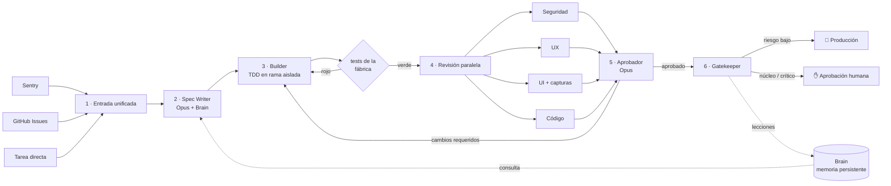

# AI Factory

Una fábrica de software con agentes: **automatizada, auditable y repetible**. Las tareas entran
por un único pipeline y salen como código probado, revisado y desplegado. Sólo los cambios
críticos esperan a un humano.



| Paso | Componente | Qué hace |
|---|---|---|
| 1 | `intake/` | Sentry, GitHub Issues y texto libre se convierten en el mismo `Task`. |
| 2 | Spec Writer | Consulta **primero** el Brain y el código, y escribe una spec con criterios de aceptación y plan de tests. |
| 3 | Builder | Crea una rama `factory/<run>` en un worktree aislado y programa con TDD hasta que los tests pasan. La fábrica **vuelve a ejecutar los tests por su cuenta**: no se fía del informe del agente. |
| 4 | Revisores | Cuatro agentes en paralelo (seguridad, UX, UI, código), cada uno con su propio modelo configurable para reducir sesgos compartidos. El de UI puede hacer capturas reales de la app con Playwright. |
| 5 | Aprobador | Analiza las revisiones, descarta falsos positivos y devuelve instrucciones concretas al Builder hasta que todo está correcto (máx. `max_iterations`). |
| 6 | Gatekeeper | Clasifica el riesgo. Bajo → se fusiona y despliega solo. Crítico (o toca `core_paths`) → PR con la etiqueta `needs-human-approval` y espera a `factory approve`. |

**Brain:** notas Markdown en `.factory/brain/` (arquitectura, decisiones, convenciones,
lecciones). Están versionadas en git, así que la memoria también es auditable. El Gatekeeper
añade lecciones nuevas en cada ejecución y viajan en el mismo commit que el cambio.

**Auditoría:** cada ejecución deja en `.factory/runs/<run_id>/` el `state.json`, la `spec.json`,
los diffs de cada iteración y un `events.jsonl` con cada llamada al modelo, cada herramienta usada,
el uso de tokens, los resultados de los tests y las decisiones tomadas.

## Instalación

```bash
pip install -e ".[dev]"          # añade ".[ui]" para capturas de UI con Playwright
export ANTHROPIC_API_KEY=sk-ant-...
```

## Uso

En el repositorio que quieres que la fábrica mantenga:

```bash
factory init                      # crea .factory/brain y factory.toml
git add .factory factory.toml && git commit -m "Añadir AI Factory"
```

Rellena `.factory/brain/architecture/overview.md` con la arquitectura real; cuanto mejor sea el
Brain, mejores serán las specs.

```bash
factory run --task "Añade paginación al listado de pedidos"
factory run --github-issue 123
factory run --sentry-json evento.json
factory intake --watch 300        # procesa issues con la etiqueta ai-factory y errores de Sentry cada 5 min
factory status
factory approve <run_id>          # aprobación humana de un cambio crítico
factory reject <run_id> --reason "..."
factory brain search "autenticación"
factory brain add decisions "Usar PostgreSQL" "Elegimos PostgreSQL por JSONB y madurez."
```

## Configuración (`factory.toml`)

Las claves más importantes (el resto, en el `factory.toml` que genera `factory init`):

- `test_command`: el comando que debe pasar para que un cambio avance.
- `core_paths`: patrones glob del núcleo. Si se tocan, siempre hace falta un humano, diga lo que diga el Gatekeeper.
- `auto_ship`: `merge` (fusiona en la rama base y hace push), `pr` (PR con auto-merge) o `none`.
- `deploy_command`: se ejecuta tras fusionar un cambio.
- `ui_preview_url`: URL de la app en ejecución para el revisor de UI.
- `[agents.<nombre>]`: `model`, `effort` y `max_tokens` de cada agente.

Modelos por defecto: Opus 5.5 para Spec Writer, Builder, revisor de seguridad, Aprobador y
Gatekeeper; Sonnet 5.5 para los revisores de UX, UI y código. Las peticiones a estos modelos usan
el *fallback* de servidor de la API (`fallbacks: "default"`): si un modelo rechaza una petición,
otro modelo continúa automáticamente. Se desactiva con `use_fallbacks = false`.

## Ejecución automática en GitHub Actions

`.github/workflows/ai-factory.yml` ejecuta la fábrica cuando a un issue se le pone la etiqueta
`ai-factory`, cada hora para revisar Sentry, y bajo demanda. Necesita el secreto `ANTHROPIC_API_KEY`
(y `SENTRY_AUTH_TOKEN` si usas Sentry).

## Seguridad

- Los agentes sólo pueden leer y escribir dentro del worktree de su ejecución; `.git` está vetado.
- `run_command` sólo admite los binarios de `allowed_commands`, y bloquea `git push/reset/checkout/rebase/clean`.
- Nada llega a la rama base sin tests en verde, aprobación del Aprobador y, si es crítico, un humano.

## Tests

```bash
pytest -q
```

Los tests usan un cliente LLM simulado y repositorios git temporales. Prueban el pipeline
completo: el despliegue de bajo riesgo, el bucle de rechazo del Aprobador, el reintento con tests
en rojo, la rendición tras `max_iterations`, el gate humano por `core_paths` y el
aprobado/rechazado manual.
