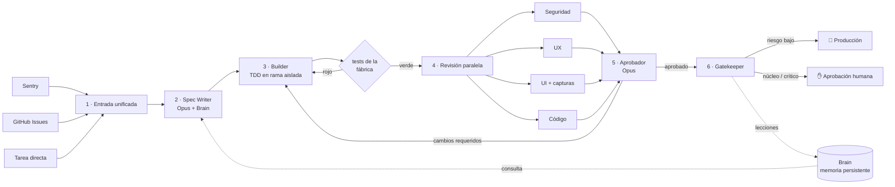

# AI Factory

Una fábrica de software con agentes: **automatizada, auditable y repetible**. Las tareas entran
por un único pipeline y salen como código probado, revisado y desplegado. Sólo los cambios
críticos esperan a un humano.



| Paso | Componente | Qué hace |
|---|---|---|
| 1 | `intake/` | Sentry, GitHub Issues y texto libre se convierten en el mismo `Task`. |
| 2 | Spec Writer | Consulta **primero** el Brain y el código, y escribe una spec con criterios de aceptación y plan de tests. |
| 3 | Builder | Crea una rama `factory/<run>` en un worktree aislado (fuera del repo, en el directorio temporal) y programa con TDD hasta que los tests pasan. La fábrica **vuelve a ejecutar los tests por su cuenta**: no se fía del informe del agente. |
| 4 | Revisores | Cuatro agentes en paralelo (seguridad, UX, UI, código), que reciben el resultado de la verificación de la fábrica, cada uno con su propio modelo configurable para reducir sesgos compartidos. El de UI puede hacer capturas reales de la app con Playwright. |
| 5 | Aprobador | Analiza las revisiones, descarta falsos positivos y devuelve instrucciones concretas al Builder hasta que todo está correcto (máx. `max_iterations`). |
| 6 | Gatekeeper | Clasifica el riesgo. Bajo → se fusiona y despliega solo. Crítico (o toca `core_paths`) → PR con la etiqueta `needs-human-approval` y espera a `factory approve`. |

**Aviso en el issue:** si la tarea viene de un issue de GitHub, al terminar la fábrica comenta el
resultado en él. Si se fusionó, enlaza el commit y cierra el issue. Si necesita aprobación humana,
enlaza el PR, que lleva `Closes #N`. Si se rechazó o falló, explica el motivo y deja el issue
abierto. El token de `gh` necesita permiso de escritura en *Issues*. Se desactiva con
`issue_feedback = false`.

**Mejora continua:** un sector con dos funciones.
- **Retrospectiva tras cada tarea** (agente `improver`). Analiza el historial de la tarea: tests en
  rojo, hallazgos de los revisores, cambios que pidió el Aprobador y tiempos por etapa. Escribe en el
  Brain hasta 3 notas duraderas que viajan en el mismo commit que el cambio, y deja sus conclusiones
  y sugerencias para la fábrica en el comentario del issue. Si la tarea no se fusiona, las notas
  sólo se proponen. Si la retrospectiva falla, la tarea no se ve afectada. Se desactiva con `retro = false`.
- **Revisión periódica del producto** (agente `scout`, comando `factory improve`). Recorre el
  repositorio y crea como mucho `improve_max_issues` issues de mejora con evidencia (`ruta:línea`) y
  criterios de aceptación, con la etiqueta `ai-factory-propuesta`. Esa etiqueta **no** lanza la
  fábrica: tú decides qué propuestas ejecutar añadiéndoles la etiqueta `ai-factory`. No repite
  issues existentes. Con `--dry-run` sólo las muestra.
- **Tareas de seguimiento.** Los revisores marcan como `out_of_scope` los problemas que ya existían
  antes del cambio. Esos hallazgos no bloquean la tarea. La retrospectiva agrupa los que merecen la
  pena en hasta `followup_issues` propuestas, con la misma etiqueta `ai-factory-propuesta`, y las
  enlaza en el comentario del issue. Así no se pierden.

**Brain:** notas Markdown en `.factory/brain/` (arquitectura, decisiones, convenciones,
lecciones). Están versionadas en git, así que la memoria también es auditable. El Gatekeeper
añade lecciones nuevas en cada ejecución y viajan en el mismo commit que el cambio.

**Auditoría:** cada ejecución deja en `.factory/runs/<run_id>/` el `state.json`, la `spec.json`,
los diffs de cada iteración y un `events.jsonl` con cada llamada al modelo, cada herramienta usada,
el uso de tokens, los resultados de los tests y las decisiones tomadas.

## Instalación

```bash
pip install -e ".[dev]"          # añade ".[ui]" para capturas de UI con Playwright
export ANTHROPIC_API_KEY=sk-ant-...
```

### Usar tu suscripción de Claude en vez de una API key

La fábrica tiene dos motores (`backend` en `factory.toml`):

| Motor | Autenticación | Coste |
|---|---|---|
| `api` (por defecto) | `ANTHROPIC_API_KEY` | Pago por uso de la API |
| `claude-code` | `CLAUDE_CODE_OAUTH_TOKEN` (suscripción Pro, Max, Team o Enterprise) | Incluido en tu suscripción; consume su cuota |

Con `backend = "claude-code"`, cada agente se ejecuta con Claude Code en modo headless
(`claude -p`) dentro de su worktree, con las herramientas de su rol:
- **Sólo lectura** (`Read`, `Glob`, `Grep`): Spec Writer, revisores, Aprobador y Gatekeeper.
- **Builder**: además `Edit`, `Write` y `Bash`, este último limitado a `allowed_commands` y a unas
  pocas utilidades de lectura; `git push/commit/reset`, `npx` y `curl` están vetados.

Todos corren en `--permission-mode dontAsk`, así que se deniega todo lo que no está permitido. La
transcripción completa de cada agente queda en `.factory/runs/<run_id>/<agente>-N.jsonl`.

```bash
curl -fsSL https://claude.ai/install.sh | bash   # instalador nativo (última versión)
claude setup-token                       # genera el token con tu suscripción
export CLAUDE_CODE_OAUTH_TOKEN=...       # o guárdalo como secreto en GitHub Actions
```

Si `CLAUDE_CODE_OAUTH_TOKEN` está definido, la fábrica quita `ANTHROPIC_API_KEY` del entorno de
Claude Code: la API key tiene prioridad y se facturaría. Ten en cuenta que una ejecución completa
lanza unos 8 agentes o más; los límites de uso de tu plan aplican. En este motor el revisor de UI
no hace capturas de pantalla.

## Uso

En el repositorio que quieres que la fábrica mantenga:

```bash
factory init                      # crea .factory/brain y factory.toml
git add .factory factory.toml && git commit -m "Añadir AI Factory"
```

Rellena `.factory/brain/architecture/overview.md` con la arquitectura real; cuanto mejor sea el
Brain, mejores serán las specs.

```bash
factory run --task "Añade paginación al listado de pedidos"
factory run --github-issue 123
factory run --sentry-json evento.json
factory intake --watch 300        # procesa issues con la etiqueta ai-factory y errores de Sentry cada 5 min
factory status
factory approve <run_id>          # aprobación humana de un cambio crítico
factory reject <run_id> --reason "..."
factory improve --dry-run         # mejora continua: muestra mejoras propuestas sin crear issues
factory improve                   # crea hasta 3 issues de propuesta (etiqueta ai-factory-propuesta)
factory brain search "autenticación"
factory brain add decisions "Usar PostgreSQL" "Elegimos PostgreSQL por JSONB y madurez."
```

## Configuración (`factory.toml`)

Las claves más importantes (el resto, en el `factory.toml` que genera `factory init`):

- `test_command`: la verificación que debe pasar para que un cambio avance. Admite `&&`, por ejemplo `npm run lint && npm test && npm run build`.
- `setup_command`: se ejecuta en cada worktree nuevo antes de que trabajen los agentes, por ejemplo `npm ci`.
- `[env]`: variables de entorno **no secretas** que necesitan los tests o la build.

**Tareas en paralelo:** se pueden lanzar varias tareas a la vez. Si otra ejecución fusiona en la
rama base mientras tanto, la fábrica la incorpora, vuelve a verificar y reintenta la fusión hasta 3
veces. Nunca sube nada sin verificar.
- `core_paths`: patrones glob del núcleo. Si se tocan, siempre hace falta un humano, diga lo que diga el Gatekeeper.
- `auto_ship`: `merge` (fusiona en la rama base y hace push), `pr` (PR con auto-merge) o `none`.
- `deploy_command`: se ejecuta tras fusionar un cambio.
- `ui_preview_url`: URL de la app en ejecución para el revisor de UI.
- `[agents.<nombre>]`: `model`, `effort` y `max_tokens` de cada agente.

Modelos por defecto: Opus 5.5 para Spec Writer, Builder, revisor de seguridad, Aprobador y
Gatekeeper; Sonnet 5.5 para los revisores de UX, UI y código. Las peticiones a estos modelos usan
el *fallback* de servidor de la API (`fallbacks: "default"`): si un modelo rechaza una petición,
otro modelo continúa automáticamente. Se desactiva con `use_fallbacks = false`.

## Ejecución automática en GitHub Actions

`.github/workflows/ai-factory.yml` ejecuta la fábrica cuando a un issue se le pone la etiqueta
`ai-factory`, cada hora para revisar Sentry, y bajo demanda. Necesita el secreto `ANTHROPIC_API_KEY`
(y `SENTRY_AUTH_TOKEN` si usas Sentry).

## Seguridad

- Los agentes sólo pueden leer y escribir dentro del worktree de su ejecución; `.git` está vetado.
- `run_command` sólo admite los binarios de `allowed_commands`, y bloquea `git push/reset/checkout/rebase/clean`.
- Nada llega a la rama base sin tests en verde, aprobación del Aprobador y, si es crítico, un humano.

## Tests

```bash
pytest -q
```

Los tests usan un cliente LLM simulado y repositorios git temporales. Prueban el pipeline
completo: el despliegue de bajo riesgo, el bucle de rechazo del Aprobador, el reintento con tests
en rojo, la rendición tras `max_iterations`, el gate humano por `core_paths` y el
aprobado/rechazado manual.
